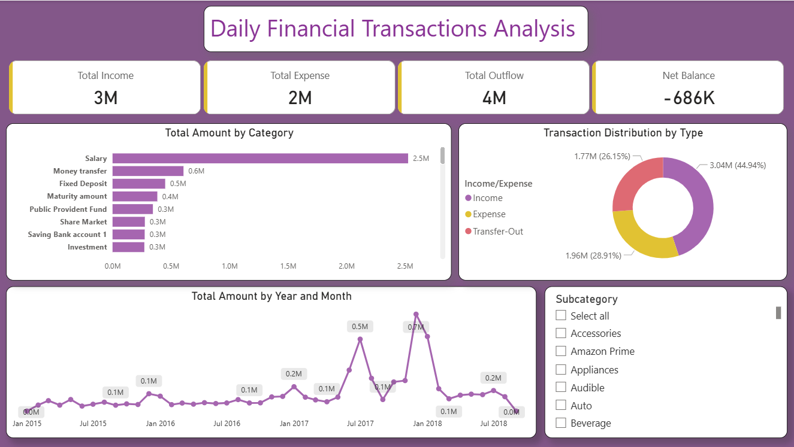

# 📊 Daily Household Financial Transaction Analysis – Power BI

## 📌 Project Overview
This project focuses on analyzing daily household financial transactions to evaluate income trends, expense distribution, and overall financial performance using Microsoft Power BI.

The objective is to transform raw transactional data into meaningful insights through data modeling, KPI development, and interactive dashboard visualization.

---

## 🎯 Project Objectives
- Analyze daily financial transactions to identify trends, patterns, and insights.
- Generate a comprehensive report with visualizations.

---

## 📂 Dataset Information
The dataset contains daily household transaction records including:
- Date
- Category
- Subcategory
- Income/Expense
- Amount
- Currency
- Mode
- Note

---

## 🛠 Tools & Technologies Used
- Microsoft Power BI
- Power Query (Data Cleaning & Transformation)
- Data Modeling
- DAX (Data Analysis Expressions)
- KPI Cards & Interactive Visualizations

---

## 🧩 Data Modeling Enhancements
- Created a Year Month calculated column for monthly trend analysis
- Implemented a Year Month Sort column to ensure correct chronological order in visuals

---

## 🧮 DAX Measures Created

The following DAX measures were created in Power BI to calculate and analyse key financial metrics.

### 1. Total Amount

`Total Amount = SUM('Daily Household Transactions'[Amount])`

Calculates the total amount of all financial transactions by adding the values in the Amount column.

### 2. Total Income

`Total Income = CALCULATE(SUM('Daily Household Transactions'[Amount]), 'Daily Household Transactions'[Income/Expense] = "Income")`

Calculates the total amount received from all income transactions.

### 3. Total Expense

`Total Expense = CALCULATE(SUM('Daily Household Transactions'[Amount]), 'Daily Household Transactions'[Income/Expense] = "Expense")`

Calculates the total amount spent on expense transactions.

### 4. Total Outflow

`Total Outflow = CALCULATE(SUM('Daily Household Transactions'[Amount]), 'Daily Household Transactions'[Income/Expense] IN {"Expense", "Transfer-Out"})`

Calculates the total amount of money going out, including expenses and outgoing transfers.

### 5. Net Balance

`Net Balance = [Total Income] - [Total Outflow]`

Calculates the remaining balance by subtracting total outflow from total income.

---

## 💡 Net Balance Calculation and Transfer Treatment

The Net Balance is calculated by subtracting Total Outflow from Total Income.

**Net Balance = Total Income - Total Outflow**

Total Outflow includes both Total Expense and Transfer-Out transactions.

- Income includes only transactions classified as Income.
- Expense includes only transactions classified as Expense.
- Transfer-Out transactions are included in Total Outflow but are not counted as expenses.

The dashboard shows a negative Net Balance of approximately **-₹685,774**. This indicates that the combined outflow, including expenses and outgoing transfers, exceeds the total income by ₹685,774.

Therefore, the negative balance represents the overall difference between income and outflow, not expenses alone.

---

## 📊 Key KPIs Developed
- Total Income
- Total Expense
- Total Outflow
- Net Balance

The analysis identified a **Negative Net Balance** indicating that total outflows exceeded total income during the selected period.

---

## 📈 Dashboard Features
- Income vs Expense comparison
- Category-wise expense distribution
- Monthly trend analysis
- Interactive slicers for filtering
- Summary KPI cards for quick financial overview

---

## 📌 Key Insights
- Clear visibility of cash inflow and outflow
- Identification of high-expense categories
- Structured financial performance tracking

---

## 🚀 Learning Outcomes
- Implemented end-to-end Power BI workflow
- Applied DAX for KPI calculations
- Built structured data model
- Designed user-focused dashboard layout
- Improved analytical storytelling skills

---

## 📌 Conclusion
This project demonstrates the practical application of business intelligence techniques in financial data analysis and highlights how structured reporting can support better financial decision-making.

---

## 📷 Dashboard Preview

